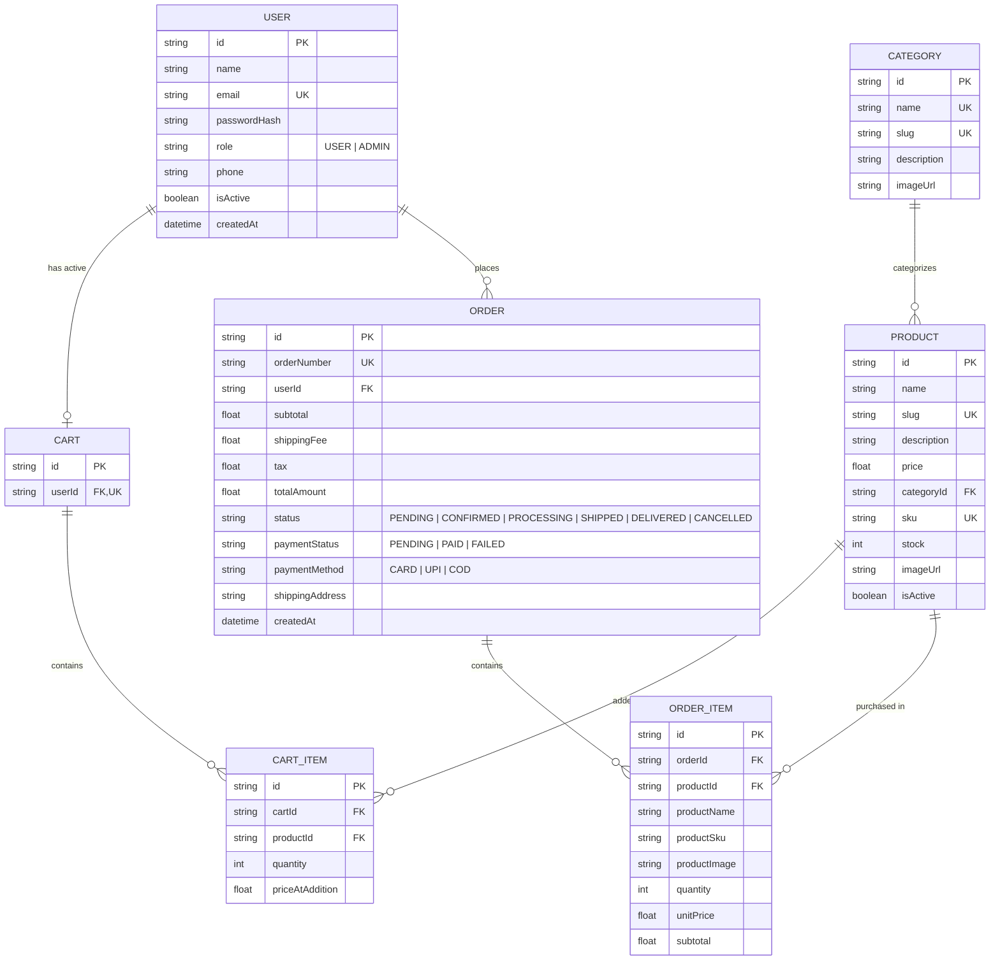

# 🛍️ ShopNexus — Production-Grade Full-Stack E-Commerce Platform

[](https://nodejs.org)
[](https://expressjs.com)
[](https://www.prisma.io)
[](https://react.dev)
[](https://tailwindcss.com)
[-brightgreen.svg)]()

ShopNexus is an enterprise-grade full-stack e-commerce web application engineered with modern architectural best practices, strict relational database integrity, secure JWT authentication with Role-Based Access Control (RBAC), atomic database transactions, server-authoritative pricing calculations, inventory auto-decrements, and an intuitive, mobile-responsive user interface.

---

## 📑 Table of Contents

1. [Project Overview](#-project-overview)
2. [Key Features](#-key-features)
3. [Architecture & System Design](#-architecture--system-design)
4. [Technology Stack](#-technology-stack)
5. [Database Schema & ER Diagram](#-database-schema--er-diagram)
6. [Folder Structure](#-folder-structure)
7. [Installation & Setup](#-installation--setup)
8. [Environment Variables](#-environment-variables)
9. [Database Migrations & Seeding](#-database-migrations--seeding)
10. [Default Demo Credentials](#-default-demo-credentials)
11. [Running the Application](#-running-the-application)
12. [API Reference Documentation](#-api-reference-documentation)
13. [Authentication & RBAC Architecture](#-authentication--rbac-architecture)
14. [Inventory Consistency & Transaction Guarantees](#-inventory-consistency--transaction-guarantees)
15. [Automated Testing Suite](#-automated-testing-suite)
16. [Security & Error Handling](#-security--error-handling)

---

## 🌟 Project Overview

ShopNexus replaces superficial college CRUD mockups with a real, hardened e-commerce engine:
- **Server as the Source of Truth**: The client is never trusted for prices, stock levels, discounts, totals, or user privileges.
- **ACID Database Transactions**: Checkout flows atomically verify stock, lock and decrement inventory, create immutable order snapshot items, and clear the user's cart in a single rollback-safe unit.
- **Strict Role-Based Authorization**: User and Administrator boundaries are enforced independently on the backend with database-backed checks.
- **Clean Responsive UI/UX**: Designed with sleek Tailwind aesthetics, optimistic cart badges, real-time inventory warnings, step-by-step checkout, and comprehensive admin dashboards with analytics.

---

## ✨ Key Features

### 👤 Customer Experience
- **Authentication**: Email/password registration and login with bcrypt hashing, JWT issuance, profile updates, and active session verification.
- **Product Catalog**: Paginated browsing, keyword search across titles/descriptions/SKUs, category filtering, min/max price sliders, in-stock availability toggles, and multi-field sorting.
- **Product Details**: High-resolution image preview, stock count indicators, SKU identifiers, dynamic quantity selectors bounded by live warehouse stock, and 1-click "Buy Now".
- **Real-Time Shopping Cart**: Synchronized cart state with optimistic updates, inventory ceiling validation, line item subtotal calculations, and free express delivery progress tracking.
- **4-Step Interactive Checkout**:
  - Step 1: Customer Contact details
  - Step 2: Physical Shipping destination
  - Step 3: Payment gateway simulation (Credit/Debit Card, UPI QR, Cash on Delivery)
  - Step 4: Final order review & authoritative calculation
- **Order Management**: Detailed order confirmation invoices, live order fulfillment timeline (`Pending` → `Confirmed` → `Processing` → `Shipped` → `Delivered`), and historical receipt review.
- **Security & Privacy**: Zero cross-user data leakage (User A is strictly prevented from inspecting User B's orders with `403 Forbidden`).

### 🛡️ Administrator Capabilities
- **Analytics Dashboard**: High-level KPIs (Total Revenue, Lifetime Orders, Active Products, Registered Users, Pending Orders, Low Stock Alerts), revenue charts, and category distributions.
- **Product Management**: Complete CRUD operations (Add, Edit, Delete with modal confirmations), category assignments, SKU collision detection, and active/inactive status toggling.
- **Inventory Control**: Real-time warehouse stock tracking, low-stock threshold badges (`≤ 5 units`), out-of-stock highlights, and 1-click quick restock actions (+5, +10, custom).
- **Order Fulfillment**: Complete administrative order table with customer details, search & filter by status, quick status updates, and automatic stock restoration upon order cancellation.
- **User Oversight**: Account directory, role badges, registration dates, order counts, and safe account activation/deactivation controls.

---

## 📐 Architecture & System Design

```
┌─────────────────────────────────────────────────────────────┐
│                       REACT FRONTEND                        │
│  (Vite + React Router + Tailwind CSS + Lucide Icons)        │
│  - Auth Context, Cart Context, Toast Notification Context   │
│  - Public Catalog, Search & Filter Sidebar, Product Details │
│  - Customer Portal (Cart, 4-Step Checkout, Orders, Profile) │
│  - Admin Dashboard (KPIs, Products, Inventory, Orders, Users)│
└──────────────────────────────┬──────────────────────────────┘
                               │ JSON REST API / JWT
┌──────────────────────────────▼──────────────────────────────┐
│                    NODE.JS + EXPRESS BACKEND                │
│  - Middleware: Helmet, CORS, Rate Limit, Auth, RBAC, Errors │
│  - Controllers & Services: Auth, Product, Cart, Order, Admin│
│  - Validators: Zod schema sanitization & input validation   │
│  - Transactional Business Logic: Inventory checks & locking │
└──────────────────────────────┬──────────────────────────────┘
                               │ Prisma Client (ORM)
┌──────────────────────────────▼──────────────────────────────┐
│                      RELATIONAL DATABASE                     │
│  - Users, Categories, Products, Carts, CartItems            │
│  - Orders, OrderItems (Historical price/name snapshot)      │
└─────────────────────────────────────────────────────────────┘
```

---

## 🛠️ Technology Stack

| Layer | Technologies |
|---|---|
| **Frontend** | React 18, Vite, Tailwind CSS, Lucide React, React Router v6, Axios |
| **Backend** | Node.js v22, Express.js, JWT, bcryptjs, Zod, Helmet, CORS, express-rate-limit, Morgan |
| **Database & ORM** | Relational Database with Prisma ORM (SQLite for zero-config local run, switchable to PostgreSQL) |
| **Testing** | Jest, Supertest, Cross-Env |

---

## 🗄️ Database Schema & ER Diagram



---

## 📁 Folder Structure

```
ecommerce/
├── backend/
│   ├── prisma/
│   │   ├── schema.prisma          # Database schema models & relations
│   │   ├── seed.js                # Rich realistic data seed script
│   │   └── dev.db                 # SQLite database file
│   ├── src/
│   │   ├── config/index.js        # Environment configurations
│   │   ├── controllers/           # Business logic & controller endpoints
│   │   ├── database/prisma.js     # Prisma ORM singleton client
│   │   ├── middleware/            # Auth, RBAC, ErrorHandler, RateLimit, Validate
│   │   ├── routes/                # Modular REST API route handlers
│   │   ├── utils/                 # Standardized response & async wrappers
│   │   ├── validators/            # Zod validation schemas
│   │   ├── app.js                 # Express application builder
│   │   └── server.js              # Server bootstrapper & graceful shutdown
│   ├── tests/                     # Automated Jest + Supertest suites
│   │   ├── auth.test.js
│   │   ├── products.test.js
│   │   ├── cart.test.js
│   │   ├── orders.test.js
│   │   └── admin.test.js
│   └── package.json
│
├── frontend/
│   ├── src/
│   │   ├── components/
│   │   │   ├── common/            # Navbar, Footer, Button, Input, Modal, Badges
│   │   │   └── store/             # ProductCard, ProductFilter, Pagination, Hero
│   │   ├── context/               # AuthContext, CartContext, ToastContext
│   │   ├── pages/
│   │   │   ├── public/            # Home, Products, ProductDetail, Login, Register
│   │   │   ├── customer/          # Cart, Checkout, OrderConfirmation, Orders, Profile
│   │   │   └── admin/             # AdminDashboard, AdminProducts, Inventory, Orders, Users
│   │   ├── routes/AppRoutes.jsx   # Route definitions and access guards
│   │   ├── services/api.js        # Axios instance with auth interceptors
│   │   ├── App.jsx                # Layout wrapper
│   │   └── main.jsx               # Entry point
│   ├── tailwind.config.js
│   ├── vite.config.js
│   └── package.json
│
├── package.json                   # Root monorepo orchestration scripts
└── README.md
```

---

## ⚙️ Installation & Setup

### Prerequisites
- Node.js `v18.x` or later (tested on Node `v22.x`)
- npm `v9.x` or later

### 1. Clone & Install Dependencies
```bash
# Clone the repository
cd ecommerce

# Install all dependencies across backend and frontend
npm run install:all
```

---

## 🔑 Environment Variables

The project includes preconfigured `.env` and `.env.example` templates in the `backend/` directory:

```env
PORT=5000
NODE_ENV=development
CLIENT_URL=http://localhost:5173
DATABASE_URL="file:./dev.db"
JWT_SECRET=shopnexus_super_secret_jwt_key_987654321_production_ready
JWT_EXPIRES_IN=7d
```

---

## 🗃️ Database Migrations & Seeding

Synchronize database tables and populate rich sample categories, 20+ products, sample orders, and accounts:

```bash
cd backend

# Sync Prisma models to database
npx prisma db push

# Seed realistic database records
node prisma/seed.js
```

---

## 👥 Default Demo Credentials

For rapid verification, the seed script provisions ready-to-use development accounts (also available via **1-Click Autofill** on the Login screen):

| Role | Email | Password | Access Level |
|---|---|---|---|
| **Administrator** | `admin@shopnexus.com` | `Admin@123456` | Full Admin Dashboard, Inventory, Products, Orders, Users |
| **Customer 1** | `john@example.com` | `User@123456` | Active shopping cart, sample order history, checkout |
| **Customer 2** | `jane@example.com` | `User@123456` | Customer portal, order history, profile |

---

## 🚀 Running the Application

### Option A: Run Both Frontend & Backend Concurrently (Recommended)
From the root project directory:
```bash
npm run dev
```

### Option B: Run Services Individually
```bash
# Terminal 1: Backend API (Port 5000)
cd backend
npm run dev

# Terminal 2: Frontend Client (Port 5173)
cd frontend
npm run dev
```

Visit the storefront in your browser at: **`http://localhost:5173`**
Backend API health check is available at: **`http://localhost:5000/api/health`**

---

## 📡 API Reference Documentation

### Authentication (`/api/auth`)
- `POST /api/auth/register` — Register a new customer account.
- `POST /api/auth/login` — Authenticate and receive signed JWT.
- `GET /api/auth/me` — Fetch currently authenticated user profile (Requires `Bearer <token>`).
- `PUT /api/auth/profile` — Update customer name and phone number.
- `POST /api/auth/logout` — Clean client session.

### Products & Categories (`/api/products`, `/api/categories`)
- `GET /api/products` — Paginated catalog with `search`, `categoryId`, `minPrice`, `maxPrice`, `inStock`, `sort`, `page`, `limit`.
- `GET /api/products/featured` — Top trending items for homepage showcase.
- `GET /api/products/:id` — Single product details by ID or slug.
- `POST /api/products` — Admin only: Create new product.
- `PUT /api/products/:id` — Admin only: Update product details.
- `DELETE /api/products/:id` — Admin only: Delete product.
- `GET /api/categories` — List all categories with product counts.
- `POST /api/categories` — Admin only: Create category.

### Shopping Cart (`/api/cart`)
- `GET /api/cart` — Get user's active cart with live item prices, stock availability, and breakdown.
- `POST /api/cart/items` — Add product to cart with inventory quantity checks.
- `PUT /api/cart/items/:id` — Update quantity of cart item.
- `DELETE /api/cart/items/:id` — Remove item from cart.
- `DELETE /api/cart` — Clear entire shopping cart.

### Orders (`/api/orders`)
- `POST /api/orders` — Place order with ACID transaction, inventory locking, and cart clearing.
- `GET /api/orders` — Get current logged-in customer's order history.
- `GET /api/orders/:id` — Get single order details (strictly restricted to owner or admin).

### Administration (`/api/admin`) *(Admin JWT Required)*
- `GET /api/admin/dashboard` — Revenue analytics, KPI metrics, order status counts.
- `GET /api/admin/orders` — Search, filter, and paginate all system orders.
- `PUT /api/admin/orders/:id/status` — Update order status (`PENDING`, `CONFIRMED`, `PROCESSING`, `SHIPPED`, `DELIVERED`, `CANCELLED`). Automatically restocks inventory if cancelled!
- `GET /api/admin/inventory` — Monitor warehouse stock levels and low-stock alerts.
- `PATCH /api/admin/inventory/:id/stock` — Quick stock increment or custom restock.
- `GET /api/admin/users` — View registered customer accounts and order totals.
- `PUT /api/admin/users/:id/status` — Toggle user account activation status.

---

## 🔒 Authentication & RBAC Architecture

The backend implements zero-trust authorization:
1. When a client requests a protected resource, the `authenticate` middleware verifies the JWT signature against `JWT_SECRET`.
2. It fetches the fresh user record directly from the database to guarantee the account is active and obtain the true database role.
3. The `authorizeAdmin` middleware checks `req.user.role === 'ADMIN'`. If a customer attempts to access `/api/admin/*`, the server immediately responds with `403 Forbidden`.
4. Order ownership is checked on individual resource retrieval: User A receives `403 Forbidden` if attempting to inspect User B's order ID.

---

## ⚡ Inventory Consistency & Transaction Guarantees

When a checkout is initiated:
1. An atomic database transaction `prisma.$transaction` is opened.
2. The server loads each product and checks `stock >= requestedQuantity`.
3. If any item is out of stock, the transaction is rolled back immediately with `400 Bad Request`.
4. The server decrements the exact quantity from the database stock.
5. The server calculates subtotal, tax (8%), shipping fee ($0 if `subtotal >= $100` else $15), and grand total.
6. The `Order` and snapshot `OrderItem`s are inserted into the database.
7. The customer's cart is wiped clean.
8. The transaction commits.

---

## 🧪 Automated Testing Suite

The repository features 32 integration tests across 5 test suites covering critical paths:

```bash
cd backend
npm test
```

### Verified Test Suites:
- `tests/auth.test.js`: Registration, duplicate email conflict, password validation, login, me endpoint.
- `tests/products.test.js`: Catalog listing, search, price sorting, admin product creation, update, deletion, non-admin rejection (403).
- `tests/cart.test.js`: Adding items, stock limit validation, quantity updates, item removal.
- `tests/orders.test.js`: Transactional checkout, stock decrements, out-of-stock rejection, user order history, cross-user privacy protection (403 Forbidden), admin status updates.
- `tests/admin.test.js`: Dashboard KPI analytics, RBAC protection, inventory queries, quick restock actions, user account listing.

---

## 🛡️ Security & Error Handling

- **Password Hashing**: bcrypt with 10 salt rounds.
- **Security Headers**: Helmet configured with cross-origin protection.
- **Rate Limiting**: `express-rate-limit` prevents brute-force login attacks.
- **CORS**: Configured with origin validation.
- **Centralized Error Handler**: Uniform error payload `{ success: false, message: "...", errors: [...] }` without leaking server stack traces in production.
